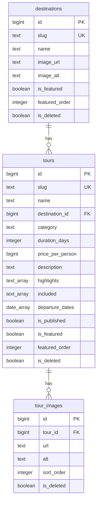

# FEAT-001 — Database design (vacasky-svc)

`spec.md` v1 is complete and merged (PR #28). The data model below is
derived from its requirements (REQ-001..REQ-028) and the fixtures in
`testcase.md` F1–F8. The catalogue is **read-only for this feature**:
tours and destinations are authored outside the site (`spec.md` non-goal —
no admin UI), and this service only reads them. Nothing in this document
adds a write path.

Engine: **PostgreSQL 15+**, accessed with `database/sql` + pgx. Migrations
are `sql-migrate` batches under `sql_migrations/main`, applied at startup.
Identifiers are addressed externally by **slug**, so the internal
`BIGSERIAL id` stays private and the slug carries a `UNIQUE` constraint.

---

## Phase 1 — Draft ERD

### Entities

**`destinations`** — the places tours are sold in (Bali, Lombok,
Yogyakarta, Komodo, Jakarta per F1).

| Column | Type | Null | Notes |
|---|---|---|---|
| `id` | `BIGSERIAL` | no | surrogate PK, internal only |
| `slug` | `TEXT` | no | public identifier, `UNIQUE`, `^[a-z0-9-]+$` |
| `name` | `TEXT` | no | display name |
| `image_url` | `TEXT` | no | card photography |
| `image_alt` | `TEXT` | no | accessible alt text (REQ-016) |
| `is_featured` | `BOOLEAN` | no | default `FALSE`; Home section (REQ-001) |
| `featured_order` | `INTEGER` | yes | `NULL` = unordered; ascending |
| `created_at` | `TIMESTAMPTZ` | no | default `now()` |
| `updated_at` | `TIMESTAMPTZ` | no | default `now()` |
| `created_by` | `BIGINT` | yes | `NULL` for system-originated rows |
| `updated_by` | `BIGINT` | yes | |
| `is_deleted` | `BOOLEAN` | no | default `FALSE` |
| `deleted_at` | `TIMESTAMPTZ` | yes | |
| `deleted_by` | `BIGINT` | yes | |

**`tours`** — the sellable product.

| Column | Type | Null | Notes |
|---|---|---|---|
| `id` | `BIGSERIAL` | no | surrogate PK |
| `slug` | `TEXT` | no | public identifier, `UNIQUE`, `^[a-z0-9-]+$` |
| `name` | `TEXT` | no | 1–120 characters |
| `destination_id` | `BIGINT` | no | FK → `destinations.id`, `ON DELETE RESTRICT` |
| `category` | `TEXT` | no | `CHECK (category IN ('Beach','Mountain','City','Culture','Adventure'))` |
| `duration_days` | `INTEGER` | no | `CHECK (duration_days >= 1)` |
| `price_per_person` | `BIGINT` | no | whole IDR, `CHECK (price_per_person >= 0)` |
| `description` | `TEXT` | no | long copy |
| `highlights` | `TEXT[]` | no | default `'{}'`; ordered as authored |
| `included` | `TEXT[]` | no | default `'{}'` |
| `departure_dates` | `DATE[]` | no | default `'{}'`; ascending as authored |
| `is_published` | `BOOLEAN` | no | default `FALSE` |
| `is_featured` | `BOOLEAN` | no | default `FALSE`; Home section (REQ-001) |
| `featured_order` | `INTEGER` | yes | `NULL` = unordered; ascending |
| `created_at` / `updated_at` | `TIMESTAMPTZ` | no | default `now()` |
| `created_by` / `updated_by` | `BIGINT` | yes | |
| `is_deleted` / `deleted_at` / `deleted_by` | | | standard soft delete |

Publishability rule (content is authored elsewhere, so the rule lives in
the schema):

```sql
CHECK (
  NOT is_published
  OR (
    length(btrim(description)) > 0
    AND coalesce(array_length(departure_dates, 1), 0) >= 1
  )
)
```

An unpublished row may be incomplete; publishing it requires a
description and at least one departure date. The "at least one image"
rule cannot live here (its truth depends on another table) — it is
enforced where content is authored, and the read API tolerates an empty
gallery.

**`tour_images`** — ordered gallery per tour.

| Column | Type | Null | Notes |
|---|---|---|---|
| `id` | `BIGSERIAL` | no | surrogate PK |
| `tour_id` | `BIGINT` | no | FK → `tours.id`, `ON DELETE CASCADE` |
| `url` | `TEXT` | no | image address |
| `alt` | `TEXT` | no | accessible alt text (REQ-016) |
| `sort_order` | `INTEGER` | no | `CHECK (sort_order >= 0)`; `UNIQUE (tour_id, sort_order)` |
| `created_at` / `updated_at` / `created_by` / `updated_by` | | | standard audit |
| `is_deleted` / `deleted_at` / `deleted_by` | | | standard soft delete |

### Relationships



- **`destinations` → `tours`** is one-to-many; a tour belongs to exactly
  one destination (the detail payload nests one `destination` object, and
  `destination` is a single-value filter — REQ-021, REQ-022).
- `ON DELETE RESTRICT`: a destination with tours cannot be hard-deleted,
  so the FK can never orphan a tour. Normal lifecycle deletion is the soft
  delete, which the read path filters.
- **`tours` → `tour_images`** is one-to-many; `ON DELETE CASCADE` is
  correct because an image has no meaning without its tour, and the
  gallery is wholly owned by the tour.
- **`tour_images` → `destinations`** does not exist: destination
  photography lives on the destination row as `image_url`, because a card
  shows exactly one image.

### Indexes

| Index | Definition | Serves |
|---|---|---|
| `tours_slug_key` | `UNIQUE (slug)` | detail lookup, uniqueness |
| `destinations_slug_key` | `UNIQUE (slug)` | destination existence check, uniqueness |
| `tour_images_tour_sort_key` | `UNIQUE (tour_id, sort_order) WHERE is_deleted = FALSE` | gallery ordering, uniqueness |
| `tours_listing_idx` | `(is_published, is_deleted, price_per_person)` | listing predicate + price sort |
| `tours_destination_idx` | `(destination_id, is_published, is_deleted)` | destination filter, and the FK check on destination delete |
| `tours_featured_idx` | `(featured_order, name, id) WHERE is_featured AND is_published AND NOT is_deleted` | Home featured-tours query |
| `destinations_featured_idx` | `(featured_order, name, id) WHERE is_featured AND NOT is_deleted` | Home featured-destinations query |

No trigram or full-text index: `SPEC` search is a case-insensitive
substring over a catalogue of dozens of tours (`ponytail:` ceiling
documented in `architecture.md` — add a GIN `pg_trgm` index on
`tours.name` and `destinations.name` when the catalogue grows).

### Phase 1 confirmation

- [x] Every entity in `spec.md` is present: destinations, tours, tour
      images, departure dates (as an array on the tour, not a separate
      entity — see Phase 2 NV-3).
- [x] Every externally addressed row has a public slug separate from the
      internal id.
- [x] Soft delete is its own lifecycle, never a `status` value.

---

## Phase 2 — Normalization review

Applied the standard taxonomy: repeating groups, partial dependency,
transitive dependency, mechanically derivable redundancy.

**NF-1 — `highlights`, `included`, `departure_dates` as arrays on
`tours`.** Each is a repeating group of scalars with no attributes of its
own, always read atomically with its tour, never filtered or joined on
independently. A child table per list would add three tables, three
joins and an ordering column to every detail read for no query the
feature actually performs. **Accepted deliberate denormalization**,
stated as such: the first normal form objection is real, and the array is
the correct answer because the child values are pure scalars read as one
list. If a future feature filters by departure date (explicitly out of
scope — `spec.md` excludes date search), it becomes a real
`tour_departure_dates` table with its own index.

**NF-2 — no transitive dependency.** `tours.destination_id` is the only
destination reference; nothing on `tours` duplicates a destination
attribute such as its name or image. The API joins for the destination
name and does not cache it on the tour.

**NV-3 — `departure_dates` as `DATE[]`.** Dates have no per-date price,
capacity, or status in the spec. A child table would be a table with one
column. Array, with the same upgrade path as NF-1.

**NV-4 — `featured_order` nullable.** `NULL` means "featured, no explicit
position", and the ordering puts those last (`NULLS LAST`) so an authored
position always wins. It is not a partial dependency — it is an ordering
attribute of the tour itself, and it is deliberately not stored on a
join table, because featuredness is a property of the tour, not of a
relationship.

**NV-5 — `tours_listing_idx` includes `is_deleted`.** The soft-delete flag
appears in a non-leading position of two indexes. This is not redundancy
to remove: the read path filters on it in every query, and a partial
index (`WHERE NOT is_deleted`) would be smaller but would have to be
recreated for each new predicate combination. At this catalogue size the
difference is noise; the explicit column keeps the index usable by the
count query and the page query alike.

**NV-6 — no `total_tours` / `tour_count` counter on `destinations`.**
Mechanically derivable (`COUNT(tours)`), never displayed by an approved
screen, and guaranteed to drift. The listing computes `total` per request.

**NV-7 — `destinations.image_url` not a `destination_images` table.** A
destination card shows exactly one image; a gallery is not in any approved
screen. One column, not a table.

**Verdict:** no true normalization defect. NF-1 and NV-3 are deliberate,
stated, and have a named upgrade path. No redundant derived column is
stored.

### Phase 2 confirmation

- [ ] Repeating groups: reviewed — NF-1, NV-3 accepted with reason.
- [ ] Partial/transitive dependency: none found.
- [ ] Derivable redundancy: none stored (NV-6).
- [ ] Each accepted exception names its ceiling and upgrade path.

---

## Phase 3 — Migration plan (batched)

Batches are ordered so each one leaves the database in a valid, queryable
state. Applied through `sql-migrate` at startup; each file is idempotent
only in the sense that `sql-migrate` records it as applied — the DDL
itself is not guarded.

**Batch 1 — `sql_migrations/main/001_create_destinations.sql`**
- Create `destinations` with all columns, the audit/soft-delete block,
  `UNIQUE (slug)`, and the two indexes (`featured` partial, name order).
- No FK yet, so nothing can fail for ordering reasons.
- Validation: table exists; inserting a destination without `image_alt`
  is rejected; duplicate slug is rejected.

**Batch 2 — `sql_migrations/main/002_create_tours.sql`**
- Create `tours` with the FK to `destinations` (`RESTRICT`), the
  `category` check, `duration_days >= 1`, `price_per_person >= 0`, the
  publishability check, `UNIQUE (slug)`, and the listing/destination/
  featured indexes.
- Validation: inserting a tour with an unknown `destination_id` is
  rejected; `category = 'Desert'` is rejected; `duration_days = 0` is
  rejected; `price_per_person = -1` is rejected; publishing with an empty
  description or no departure dates is rejected; deleting a referenced
  destination is rejected.

**Batch 3 — `sql_migrations/main/003_create_tour_images.sql`**
- Create `tour_images` with the FK to `tours` (`CASCADE`),
  `sort_order >= 0`, the partial `UNIQUE (tour_id, sort_order)`.
- Validation: two live images at the same `sort_order` on one tour are
  rejected; deleting a tour removes its images.

**Batch 4 — `sql_migrations/seed/001_fixtures.sql`**
- Insert the F1–F8 fixtures from `testcase.md`: 30 published tours across
  Bali (12), Lombok (6), Yogyakarta (5), Komodo (4) and Jakarta (3), the
  named anchor tours used by the test cases, plus at least one
  unpublished tour, one unpublished-destination case, one destination
  with no published tours, and featured/ordered rows for both Home
  sections.
- Seeded as explicit `INSERT ... ON CONFLICT (slug) DO NOTHING` so the
  seed is safe to re-run.
- Validation: `SELECT count(*) FROM tours WHERE is_published` returns 30;
  the featured tours query returns at most 6 in `featured_order`;
  `GET /v1/destinations` includes a destination with zero published
  tours.

**Ordering and rollback.** The order is dependency-safe
(destinations → tours → tour_images → seed). `sql-migrate` records a
down migration per file; the down files are `DROP TABLE` in reverse
order, and the seed's down deletes only the rows it inserted by slug.
This is a new service, so the migrations run against an empty database
and no backfill, rename or data migration is required.

### Phase 3 confirmation

- [ ] Batches ordered so every intermediate state is valid.
- [ ] Seed reproduces the `testcase.md` fixtures and is re-runnable.
- [ ] No destructive change to any existing table (greenfield).

---

## Notes carried to `/go-dev`

- The read path must filter `is_deleted = FALSE` on all three tables;
  `tours` additionally filters `is_published = TRUE` on every public query.
- The destination existence check is a single indexed `SELECT EXISTS` on
  `destinations.slug`; when it returns false, the service drops the filter
  rather than returning an empty page (REQ-021).
- Search uses `strpos(lower(...), lower($q)) > 0` on `tours.name` or
  `destinations.name` — no `LIKE`, so `%` and `_` need no escaping.
- Pagination is `COUNT(*)` + `LIMIT 12 OFFSET (page-1)*12` in one
  read-committed transaction; `page` is clamped to `total_pages` in the
  service layer and the effective page returned.
- Prices are `BIGINT` whole rupiah; Go reads them as `int64` and the
  frontend formats them — no floating point anywhere in the money path.
